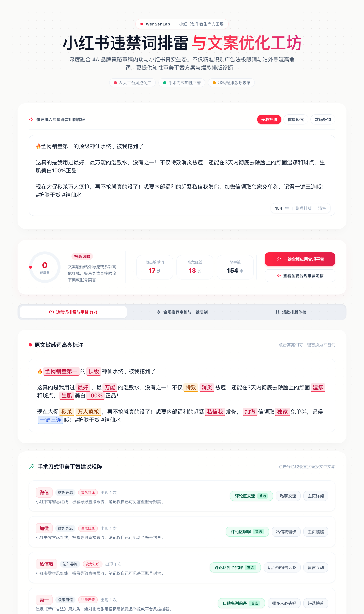

# 🔍 小红书违禁词排雷与优化工坊 (XHS Content Studio)

> 智能识别小红书违禁词、广告法极限词与站外导流高危词，提供**知性审美平替方案、一键合规改写与爆款排版生态诊断**。守护创作者内容安全，告别笔记限流与封号焦虑！

---

## 🌐 在线体验与界面预览

- **GitHub Pages 演示地址**：[https://wensenlab.github.io/xhs-content-checker/](https://wensenlab.github.io/xhs-content-checker/)

---

## ✨ 核心特性

**由 WenSenLab · 文森策倾力打造**，深度融合十余年 4A 营销策划审稿内功与小红书真实创作者痛点：

### 1. 🎯 8 大敏感词库全景排雷（新增「站外导流」专项）
- **🚨 站外导流（小红书零容忍红线）**：微信、加微、加v、vx、公众号、淘宝、拼多多、自取外链、私信领等（规避最严重的直接限流与禁言封号风险）；
- **🔴 极限用语**：国家级、顶级、第一、全网首发、独家、销量冠军、NO1、Top1、史无前例等；
- **🟠 医疗与功效宣传**：消炎、抗敏、排毒、防癌、生发止脱、降血压、祛斑、牛皮癣等非药宣药用语；
- **🟡 化妆品虚假宣称**：特效、全效、速白、周期见效、溶脂、抚平细纹等；
- **🏛️ 权威性背书**：国家领导人推荐、国家机关专供、质量免检、中国驰名商标等；
- **⚡ 刺激消费与虚假紧迫**：秒杀、抢爆、再不抢就没了、万人疯抢等；
- **👆 诱导点击与粗暴互动**：恭喜获奖、全民免单、一键三连等；
- **🔮 迷信用语**：招财进宝、转运、逢凶化吉、旺人旺财等。

### 2. 💡 知性审美平替改写引擎（Term Replacement Matrix）
- 拒绝生硬删词，内置**客观数据流、场景通感流、留白克制流**三大知性平替策略；
- **单个平替一键替换**：在平替建议卡片中点击心仪的平替词，直接替换输入框中的原词；
- **一键全篇合规定稿**：一键将整篇文案中的违规用词智能批量替换为通顺平替，并支持一键复制到剪贴板。

### 3. 📱 移动端排版与生态体检（Content Diagnostics）
- **字数区间评估**：识别是否处于 200~600 字的小红书黄金阅读与搜索沉淀区间；
- **手机端排版呼吸感**：检测是否存在长段落堆砌（单段超 120 字），提醒适度换行或添加 Emoji 提升视觉节奏；
- **话题标签诊断**：检查是否包含 `#话题` 标签，防范无标签错失算法推流或标签过多判定为堆砌；
- **互动留白钩子**：检查文末是否自然保留互动问句，助力拉升评论区完播与互动权重。

---

## 🚀 部署与使用

本项目保持极简轻量、零依赖运行的原则：

### 方案一：双击直接运行（离线/免安装）
直接双击打开 [`index.html`](index.html)，现代浏览器均可直接流畅运行。

### 方案二：GitHub Pages 自动部署
仓库已内置 Actions，向 `main` 分支提交代码后即自动完成构建与全球 CDN 部署。

### 方案三：集成到 React / Vite / Next.js 工程
直接引入仓库提供的 [`XiaohongshuChecker.jsx`](XiaohongshuChecker.jsx) 组件即可。

---

## 📄 授权协议

本项目采用 [MIT License](LICENSE) 开源协议。

---

  <b>WenSenLab_ ©文森策</b>

